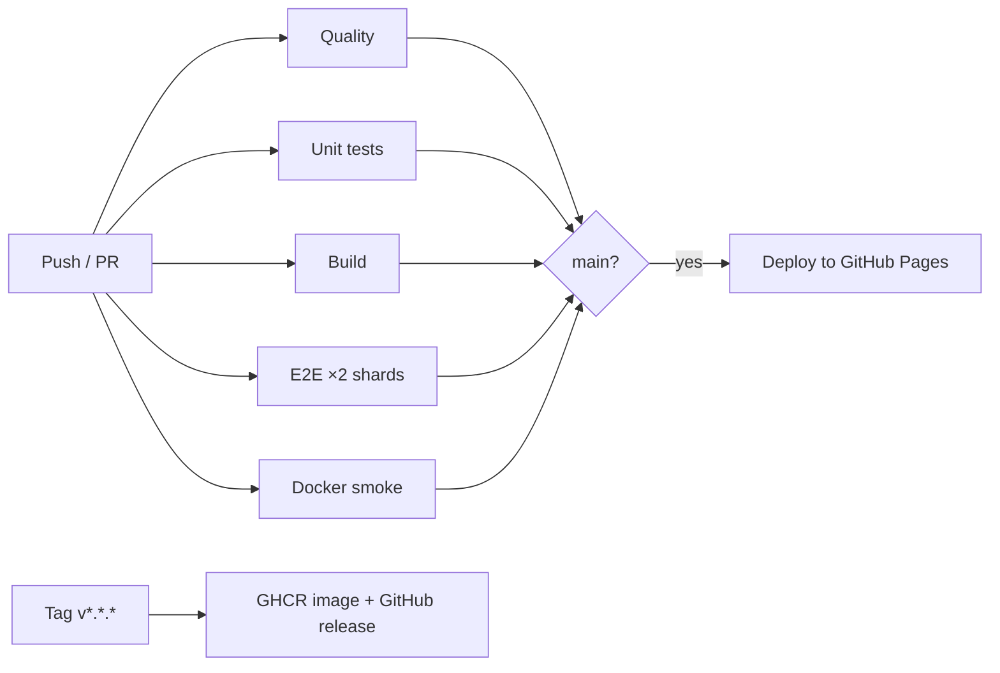

<div align="center">

# 🧠 Cognitive Index

#### A 15-minute, 20-question reasoning test that places you on the IQ scale, entirely in your browser.


</div>

---

## Tech Stack


---

## Overview

Cognitive Index is a timed reasoning assessment with 20 questions across four domains: pattern matrices, number
sequences, verbal and spatial reasoning, and deduction. It weights answers by difficulty, adds a small bonus for
time left, and compares the result with a norm for your age group. The score is reported on the familiar IQ scale
(mean 100, SD 15), with a percentile, a per-domain breakdown and a full answer review.

**Why use it:** it runs as a static site with no server, account, cookies or tracking. Everything stays in your
browser's `localStorage`, and progress survives a reload.

**Why not:** the age norms are illustrative calibration values, not published population data, so this is a
practice tool, not a clinical or standardised test. The bank has 20 fixed questions, and the scoring runs on the
user's own device, so the app cannot stop someone from cheating.

---

## Features

- 🧩 20 questions in 4 domains, rendered as inline SVG matrices, sequences and rotation figures
- ⏱️ 15-minute deadline-based timer that auto-submits at 00:00 and survives reloads and sleep
- 💾 Resumable sessions and a history of up to 50 results, stored locally
- 🚩 Skip, go back, jump from the overview grid, and flag questions for review
- ⌨️ Keyboard shortcuts: `1`–`4` / `A`–`D` to answer, `←` `→` to move, `F` to flag
- 📈 Results with percentile, an interactive bell curve (mouse or keyboard), domain accuracy and a trend sparkline
- 🧮 A "How this score was calculated" panel showing every step of the formula
- 🔍 Answer review with explanations, filterable by incorrect, unanswered or flagged
- ♿ WCAG 2.2 AA: 0 axe violations on every screen; screen-reader descriptions for every figure
- 🔒 Strict Content-Security-Policy with no `unsafe-inline`; all stored data is schema-validated before rendering

---

## Quick Start

```bash
git clone <your-repo-url> cognitive-index
cd cognitive-index
npm ci
npm run dev
```

Open http://localhost:5173.

<details>
<summary>📋 <b>Detailed Setup Guide</b></summary>

### a. Prerequisites

| Tool    | Version                            | Source                             |
| ------- | ---------------------------------- | ---------------------------------- |
| Node.js | ≥ 22.12 (24 recommended)           | `package.json` `engines`, `.nvmrc` |
| npm     | ships with Node                    | `package-lock.json`                |
| Docker  | optional, for the production image | `Dockerfile`                       |

### b. Clone & install

```bash
git clone <your-repo-url> cognitive-index
cd cognitive-index
nvm use          # optional: switches to the Node version in .nvmrc
npm ci           # also installs the Git pre-commit hook
```

### c. Environment variables

None are required. The app is fully static and has no secrets. `.env.example` records this, and lists the one
optional variable read by the test config:

| Variable              | Required | Description                                                                       | Example                 |
| --------------------- | -------- | --------------------------------------------------------------------------------- | ----------------------- |
| `CI`                  | No       | Turns on CI behaviour in Playwright (retries, `forbidOnly`, CI reporters)         | `true`                  |
| `PLAYWRIGHT_BASE_URL` | No       | Runs the E2E suite against an already running deployment instead of a local build | `http://localhost:8080` |

### d. Database setup

Not applicable: data lives in the browser's `localStorage` (`cogidx.active.v1`, `cogidx.history.v1`).

### e. Run the development server

```bash
npm run dev          # http://localhost:5173 with hot reload
npm run build        # typecheck + production build into dist/
npm run preview      # serve dist/ on http://localhost:4173
```

### f. Run Playwright tests

```bash
npx playwright install --with-deps   # first time only
npm run test:e2e                     # all 5 projects
npm run test:e2e:ui                  # interactive UI mode (npx playwright test --ui)
npm run test:e2e:report              # open the HTML report (npx playwright show-report)
```

</details>

<details>
<summary>📁 <b>Project Structure</b></summary>

```
.
├── .github/
│   ├── workflows/          # ci.yml, deploy.yml, release.yml, codeql.yml
│   ├── dependabot.yml      # weekly npm, Actions and Docker updates
│   └── ISSUE_TEMPLATE/     # bug report form (+ pull_request_template.md)
├── .husky/                 # pre-commit hook → lint-staged
├── docker/                 # nginx.conf and security-headers.conf for the container
├── docs/                   # architecture, scoring method, audit reports
├── public/                 # favicon.svg (copied as-is into the build)
├── src/
│   ├── data/               # questions.ts: the 20-question bank
│   ├── lib/                # pure logic: scoring, maths, storage validation, SVG rendering
│   ├── styles/             # base, components and per-screen CSS
│   ├── ui/                 # one module per screen + modal/toast + error handling
│   ├── app.ts              # wires the screens together
│   ├── config.ts           # time limit, weights, IQ scale, age norms
│   ├── main.ts             # entry point
│   └── types.ts            # shared types
├── tests/
│   ├── unit/               # Vitest: scoring, maths, storage, rendering, bank integrity
│   └── e2e/                # Playwright specs, fixtures.ts, pages/ (page objects)
├── Dockerfile              # multi-stage build → non-root nginx
├── docker-compose.yml      # hardened local production run
├── index.html              # app shell
├── playwright.config.ts
└── vite.config.ts          # build, CSP injection, Vitest config
```

See [docs/architecture.md](docs/architecture.md) for the dependency rules and state model.

</details>

---

## 🧪 Testing

Unit tests cover the scoring and data logic. Playwright covers every user flow end to end in Chromium, Firefox,
WebKit, a Pixel 7 and an iPhone 14 profile, against the production build.

```bash
npm test                                   # 90 unit tests (Vitest)
npm run test:coverage                      # with coverage (≥ 90 % enforced on src/lib, src/data)
npm run test:e2e                           # 33 tests × 5 projects = 165 runs
npx playwright test tests/e2e/quiz.spec.ts # a single file
npm run test:e2e:headed                    # headed, Chromium only
npm run test:e2e:ui                        # Playwright UI mode
npm run check                              # typecheck + lint + format check + unit tests
```

The E2E suite also:

- runs axe-core WCAG 2.2 AA scans on every screen;
- fails any test that triggers a CSP violation or a console error;
- drives the timer with a frozen fake clock;
- checks behaviour when storage is corrupt or blocked.


---

## ⚙️ CI/CD

| Workflow                                       | Trigger                          | What it does                                                                                                                                                                                                                                                          |
| ---------------------------------------------- | -------------------------------- | --------------------------------------------------------------------------------------------------------------------------------------------------------------------------------------------------------------------------------------------------------------------- |
| [`ci.yml`](.github/workflows/ci.yml)           | PRs, pushes to `main`, manual    | Typecheck, lint, format, `npm audit`; unit tests on Node 22 and 24; production build; Playwright in the official container, sharded 2 ways, with reports and traces uploaded; Docker build with health check and security-header assertions; dependency review on PRs |
| [`deploy.yml`](.github/workflows/deploy.yml)   | CI succeeds on `main`, or manual | Builds the exact commit CI verified and deploys it to GitHub Pages. Run it manually with an older tag or SHA to roll back                                                                                                                                             |
| [`release.yml`](.github/workflows/release.yml) | `v*.*.*` tag                     | Publishes a semver-tagged image to GHCR (with SBOM and provenance) and a GitHub release with the zipped site                                                                                                                                                          |
| [`codeql.yml`](.github/workflows/codeql.yml)   | PRs, pushes to `main`, weekly    | CodeQL `security-extended` analysis                                                                                                                                                                                                                                   |

All actions are pinned to commit SHAs, and each job gets only the permissions it needs.



---

## 🚀 Deployment

**GitHub Pages (default).** In the repository settings, set **Pages → Source** to **GitHub Actions**. Every green
CI run on `main` then deploys automatically. To add a manual approval step, add required reviewers to the
`github-pages` environment.

**Docker (any container host).** The image serves the site from non-root nginx on port 8080. It sends the full
security-header set (CSP, HSTS, `X-Frame-Options`, and others), exposes `/healthz`, and runs with a read-only
filesystem.

```bash
docker compose up --build        # http://localhost:8080
# or
docker build -t cognitive-index .
docker run -p 8080:8080 --read-only --tmpfs /tmp --cap-drop ALL cognitive-index
```

Tagged releases publish `ghcr.io/<owner>/<repo>:<version>`.

> GitHub Pages cannot send custom headers, so the CSP there is delivered by `<meta>`, which can't block framing.
> Use the Docker image, or a CDN in front of Pages, when you need header-level protection.

---

## Design Goals

- **Zero runtime dependencies.** The shipped bundle is about 22 KB gzipped: TypeScript compiled by Vite, with no
  framework and no third-party scripts.
- **Private by construction.** There is no backend and no network access (`connect-src 'self'`); all state stays
  in the browser.
- **Pure core, thin UI.** Scoring, validation and rendering live in `src/lib` as pure, unit-tested functions.
  Screens in `src/ui` never import each other.
- **Accessible and secure by default.** Accessibility (axe) and CSP compliance are checked in CI on every change,
  not left as a one-off review.

---

## 🤝 Contributing

Contributions are welcome. [CONTRIBUTING.md](CONTRIBUTING.md) covers setup, conventions (Conventional Commits,
page-object tests, no inline styles or scripts) and how to edit the question bank. Before opening a PR, run
`npm run check` and `npm run test:e2e`. Please follow the [Code of Conduct](CODE_OF_CONDUCT.md), and report
vulnerabilities privately as described in [SECURITY.md](SECURITY.md).

---

## 📄 License

Released under the MIT License. See [LICENSE](LICENSE).

---

## Deployment Readiness

Pre-deployment audits run on 2026-09-26. Full reports are in [docs/audits](docs/audits).

| Audit                | Score                                                                         | Status                                      |
| -------------------- | ----------------------------------------------------------------------------- | ------------------------------------------- |
| Frontend             |  | DEPLOY                                      |
| Backend              |       | N/A: no backend                             |
| Playwright Tests     |  | DEPLOY                                      |
| Security             |  | DEPLOY                                      |
| Architecture & CI/CD |       | HOLD until the first hosted CI run is green |
